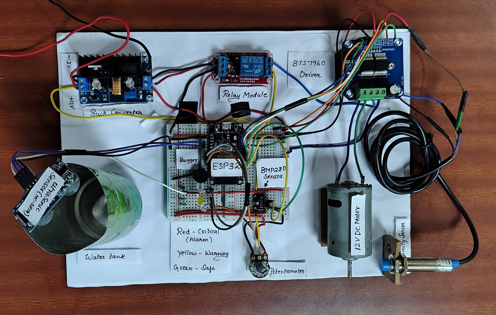
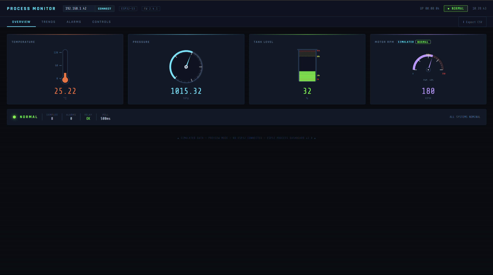
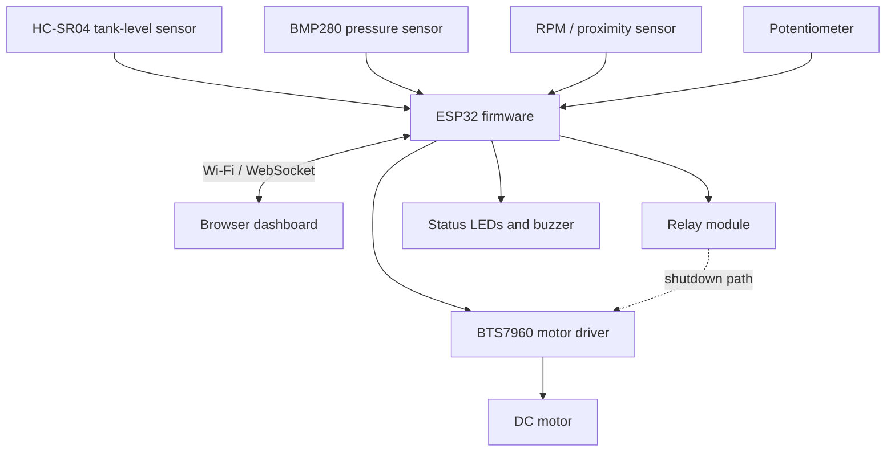

# Web-Based Industrial Process Control System Using ESP32

A Wi-Fi-enabled industrial process monitoring and control prototype built with an ESP32, sensors, a DC motor, a BTS7960 motor driver, a relay module, and a browser-based dashboard. The design demonstrates local telemetry, WebSocket communication, threshold-based alarms, and motor shutdown logic without requiring a cloud service.

<p align="center">
  
</p>

<p align="center"><em>Hardware prototype: ESP32, power converter, relay, BTS7960 driver, pressure sensor, ultrasonic tank-level sensor, motor, potentiometer, and wiring.</em></p>

## Dashboard Preview

<p align="center">
  
</p>

> **Dashboard status:** The supplied screenshot is marked as simulated preview mode with no ESP32 connected. The values shown in that screenshot are not evidence of a live hardware connection. Confirm the live connection and sensor readings during your own test.

## Project Overview

The ESP32 collects process data and serves a web interface over the local Wi-Fi network. A browser can display sensor readings and send supported control commands through WebSocket.

The prototype is intended for embedded-systems learning and small-scale demonstrations of industrial monitoring concepts.

### Main functions

- Monitor tank level using an HC-SR04 ultrasonic sensor.
- Read barometric pressure using a BMP280 sensor.
- Count pulses from an RPM/proximity sensor.
- Read a manual motor-duty setpoint from a potentiometer.
- Drive a DC motor using a BTS7960 H-bridge driver.
- Display normal, warning, and alarm states.
- Trigger a buzzer and relay output when the firmware detects an alarm.
- Exchange telemetry and control commands over WebSocket.
- Operate locally on the same Wi-Fi network without cloud connectivity.

**Measurement note:** The uploaded firmware generates temperature values in software and can simulate pressure if the BMP280 is not initialized. Treat these values as simulated unless a real sensor is connected and its reading has been verified.

## Hardware Components

| Component | Purpose |
|---|---|
| ESP32 development board | Main controller and Wi-Fi interface |
| BMP280 pressure sensor | Barometric pressure measurement |
| HC-SR04 ultrasonic sensor | Tank-level measurement |
| RPM/proximity sensor | Motor pulse input |
| Potentiometer | Manual motor-duty input |
| BTS7960 motor driver | DC motor power and PWM control |
| Relay module | Shutdown path for the motor-driver supply |
| DC motor | Demonstration actuator |
| Red, yellow, and green LEDs | Critical, warning, and normal indication |
| Buzzer | Audible alarm |
| Buck converter and DC supply | Power conversion and distribution |
| Breadboard, wiring, and tank | Prototype assembly |

Check the exact board and module versions before wiring. The project materials refer to both an ESP32 DevKit V1 and an ESP32-S3 in different places, so confirm the actual board used with the firmware.

## System Architecture



## Software Stack

- **Firmware:** Arduino C++ (`esp32_v9.ino`)
- **Microcontroller platform:** ESP32 Arduino core
- **Communication:** Wi-Fi and WebSocket
- **Web server:** ESPAsyncWebServer
- **JSON handling:** ArduinoJson
- **Pressure sensor library:** Adafruit BMP280 Library
- **Development tools:** Arduino IDE or PlatformIO
- **Dashboard:** HTML, CSS, and JavaScript served by the device, according to the project description

Install the required libraries through Arduino IDE Library Manager or configure equivalent dependencies in PlatformIO.

## Wiring Reference

The following table summarizes the GPIO definitions found in the uploaded firmware. Verify the pinout against your exact ESP32 board before connecting hardware.

| Function | GPIO in firmware | Notes |
|---|---:|---|
| HC-SR04 TRIG | 4 | Output |
| HC-SR04 ECHO | 2 | Use a voltage divider or level shifter if the ECHO output is 5 V |
| RPM sensor output | 14 | Pulse/interrupt input |
| Potentiometer wiper | 32 | ADC input; keep within the ESP32 input-voltage limits |
| BTS7960 RPWM | 33 | PWM output |
| BTS7960 LPWM | 25 | PWM output |
| BTS7960 R_EN | 26 | Driver enable |
| BTS7960 L_EN | 27 | Driver enable |
| Relay input | 13 | Firmware uses active-low relay logic |
| Red LED | 5 | Use a current-limiting resistor |
| Yellow LED | 18 | Use a current-limiting resistor |
| Green LED | 19 | Use a current-limiting resistor |
| Buzzer | 23 in the firmware definition | A wiring comment in the sketch says GPIO 22; resolve this mismatch |
| BMP280 SDA/SCL | 35/34 in the firmware definitions | These pins are input-only on a classic ESP32 and cannot serve as I²C SDA/SCL |

### Important wiring checks

1. **BMP280 I²C:** On a classic ESP32 DevKit V1, GPIO 34 and GPIO 35 are input-only. They cannot drive I²C SDA/SCL. Move I²C to suitable output-capable pins (GPIO 21/22 are commonly used on classic ESP32 boards) and update the code consistently. Confirm your exact board's pin capabilities.
2. **Buzzer:** The firmware definition and wiring comment disagree about GPIO 22 versus GPIO 23. Make the code and physical connection agree before powering the circuit.
3. **HC-SR04 ECHO:** Do not feed a 5 V ECHO signal directly into an ESP32 GPIO. Use a suitable divider or level shifter.
4. **Motor supply:** Do not power the DC motor from the ESP32 3.3 V output. Use a motor supply and driver rated for the motor's startup and stall current.
5. **Ground and power:** Follow the module documentation for common-ground requirements, current paths, fusing, and supply ratings.

## Getting Started

### 1. Clone the repository

```bash
git clone https://github.com/JOTHIRNADHREDDY/Web-Based-Industrial-Process-Control-System-Using-ESP32.git
cd Web-Based-Industrial-Process-Control-System-Using-ESP32
```

### 2. Configure Wi-Fi

Update the SSID and password in `esp32_v9.ino`:

```cpp
const char* ssid = "YOUR_WIFI_SSID";
const char* password = "YOUR_WIFI_PASSWORD";
```

Do not commit real Wi-Fi credentials to a public repository.

### 3. Select the board and verify pins

- Select the correct ESP32 board and serial port in Arduino IDE.
- Resolve the BMP280 I²C pin issue and buzzer GPIO mismatch.
- Confirm relay polarity and BTS7960 wiring.
- Check the HC-SR04 ECHO voltage level.

### 4. Install libraries and upload

1. Install the libraries listed in the Software Stack section.
2. Connect the ESP32 using a USB data cable.
3. Compile and upload `esp32_v9.ino`.
4. Open Serial Monitor at **115200 baud**.
5. Check the startup logs for Wi-Fi connection status and the assigned local IP address.

### 5. Open the dashboard

Connect a computer or phone to the same local Wi-Fi network as the ESP32. Open the device's local IP address in a browser. The firmware's WebSocket endpoint is:

```text
ws://<ESP32-IP>/ws
```

Use the live connection status and serial output to confirm that the dashboard is receiving actual device data. If your repository's dashboard files have a separate launch procedure, follow those files' instructions.

## WebSocket Command Examples

The firmware parses JSON commands received through WebSocket.

### Update alarm thresholds

```json
{
  "cmd": "SET_THRESH",
  "presW": 1070,
  "presA": 1090,
  "lvlLoW": 20,
  "lvlLoA": 5,
  "lvlHiW": 80,
  "lvlHiA": 95,
  "rpmW": 200,
  "rpmA": 300
}
```

### Set motor duty

```json
{"cmd": "SET_MOTOR", "duty": 75}
```

A positive duty value from 0 to 100 enables dashboard override. Sending `0` returns control to the potentiometer in the supplied sketch.

### Set tank-level target

```json
{"cmd": "SET_LEVEL", "target": 65}
```

### Set motor and level setpoints together

```json
{"cmd": "SET_SETPOINTS", "motorDuty": 60, "levelTarget": 65}
```

### Acknowledge alarms or reset the relay

```json
{"cmd": "ACK"}
```

```json
{"cmd": "RELAY_RESET"}
```

Only reset a tripped output after checking the cause and confirming it is safe to resume. Acknowledging an alarm does not prove that the underlying fault has been resolved.

## Initial Alarm Thresholds

| Parameter | Initial value in firmware |
|---|---:|
| Pressure warning | 1070 hPa |
| Pressure alarm | 1090 hPa |
| Low-level warning | 20% |
| Low-level alarm | 5% |
| High-level warning | 80% |
| High-level alarm | 95% |
| RPM warning | 200 RPM |
| RPM alarm | 300 RPM |

These are firmware defaults, not validated industrial safety limits. Calibrate sensors and set thresholds for the intended demonstration before use.

## Testing Checklist

- [ ] Confirm ESP32 boot and Wi-Fi connection in Serial Monitor.
- [ ] Verify BMP280 pressure readings against a known reference.
- [ ] Check tank-level readings at known distances, including the ultrasonic sensor's blind zone.
- [ ] Confirm RPM pulse counting and potentiometer input.
- [ ] Connect the dashboard and verify live telemetry rather than preview data.
- [ ] Test motor operation at low duty with the motor secured.
- [ ] Test warning and alarm states using safe, controlled conditions.
- [ ] Test relay logic with the motor supply isolated before testing a powered load.
- [ ] Verify safe behavior when a sensor is disconnected.

The accompanying presentation reports passing results for several test scenarios. Repeat these tests on the assembled hardware and document measured outcomes before treating them as independently verified.

## Troubleshooting

| Problem | Things to check |
|---|---|
| Wi-Fi connection fails | SSID/password, 2.4 GHz support, signal strength, and serial logs |
| Dashboard will not connect | Local IP, same Wi-Fi network, server startup, and `/ws` path |
| BMP280 is not detected | Sensor supply, I²C address, wiring, and valid I²C-capable pins |
| Tank level is stuck or inaccurate | TRIG/ECHO wiring, voltage divider, sensor alignment, blind zone, and tank geometry |
| RPM stays at zero | Sensor output, common ground, GPIO 14, and pulses per revolution |
| Motor does not run | Motor supply, BTS7960 wiring, enable pins, PWM pins, and relay state |
| Relay trips unexpectedly | Thresholds, sensor validity, relay active level, and wiring |
| Buzzer does not sound | Resolve the GPIO 22/23 mismatch and check buzzer polarity |

## Safety Disclaimer

This is an educational prototype, **not a certified industrial safety controller**. Do not connect it directly to mains voltage, hazardous processes, pressure vessels, or production machinery without a qualified engineering review. Use appropriate fuses, insulated terminals, strain relief, rated wiring, and a correctly sized motor supply. Verify the relay's de-energized state and actual power-interruption behavior. Never rely on simulated readings for process protection.

## Future Improvements

- Add and validate a real temperature sensor.
- Clearly flag simulated, stale, and invalid sensor readings in the dashboard.
- Calibrate pressure and tank-level measurements.
- Confirm the final board variant and publish a consistent wiring diagram.
- Add timestamped logging and CSV export for verified live measurements.
- Add a dedicated hardware emergency-stop circuit.
- Document repeatable hardware and firmware test results.

## Author

**Jothirnadh Reddy Peram**

Repository: [Web-Based Industrial Process Control System Using ESP32](https://github.com/JOTHIRNADHREDDY/Web-Based-Industrial-Process-Control-System-Using-ESP32)
